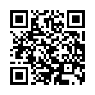

<!-- SPDX-License-Identifier: GPL-3.0-only -->

# cosmostrix Commercial License

cosmostrix is dual-licensed:

- **GPL-3.0-only** for open-source use — see [LICENSE](LICENSE).
- **Commercial License** for proprietary and commercial use — this document.

If your use of cosmostrix satisfies the GPL-3.0-only copyleft terms, you may
use it for free under the open-source license. If it cannot — because you
ship a closed-source product, run a paid hosted service, or keep internal
business tooling proprietary — you need a commercial license. This document
defines who needs one, what each tier grants, and how to buy it.

## Who Needs a Commercial License

You need a commercial license if any of the following applies:

- Your company runs cosmostrix in production as part of its business.
- You offer a SaaS or any paid hosted service built on cosmostrix.
- You build internal business tools around cosmostrix and cannot release
  the surrounding proprietary code under GPL-3.0-only.
- You redistribute cosmostrix, in whole or in part, inside a product you
  distribute or sell.
- Any other use that cannot meet the copyleft obligations of GPL-3.0-only.

## Who Does NOT Need a Commercial License

You do not need a commercial license for:

- Personal use, hobby projects, and experimentation.
- Non-commercial research and evaluation.
- Education and teaching.
- Open-source contributions back to the upstream project — contribution
  forks are covered by GPL-3.0-only and [TRADEMARK.md](TRADEMARK.md) §4a.

In all of these cases the GPL-3.0-only license in [LICENSE](LICENSE) is
sufficient and no payment is required.

## Pricing

All prices are annual, pegged to USD, and payable in cryptocurrency (see
[Payment](#payment)). Tiers are self-declared by the buyer in good faith.

| Tier                 | Price          | Target                                                        |
| -------------------- | -------------- | ------------------------------------------------------------- |
| Personal             | Free (GPL-3.0) | Hobby, personal, non-commercial, open-source contributions    |
| Individual           | $99/year       | Solo devs, freelancers, revenue < $100K/year                  |
| Business             | $12,999/year   | SMB, revenue $100K–$10M/year                                  |
| Enterprise Internal  | $64,999/year   | Enterprise (>$10M/year), internal use only, NO redistribution |
| OEM / Redistribution | $149,999/year  | Embedding the architectural patterns in a shipped product     |

Multi-year contracts are available at the owner's discretion: 20% off a
2-year contract, 30% off a 3-year contract. No free tier above Personal is
granted without explicit owner approval.

### Pricing Philosophy

cosmostrix is a professional-grade renderer, and it is priced like one.
Every hardening pass, dependency audit, LTS release, and benchmark
campaign raises the value of the codebase year by year — the Business
and Company tiers track that rising value deliberately. A company
buying a license is not buying a screensaver; it is buying the
accumulated engineering of hundreds of audited releases, and the
price will keep increasing as that engineering compounds. Budget
accordingly: today's price is the lowest it will ever be.

Recorded raises:

- October 2026 (night-improve-6): Business $5,000 to $5,199/year,
  Company $50,199 to $100,199/year.
- October 2026 (this revision): Business $5,199 to $12,999/year,
  Company $100,199 split into Enterprise Internal ($64,999/year,
  internal-only) and OEM / Redistribution ($149,999/year,
  embedding rights).

The Personal and Individual tiers are deliberately untouched across
every raise — the increases track the compounding engineering value
and apply only to the tiers that profit commercially from it.

### Why cosmostrix is priced above the infrastructure tools

cosmostrix licenses more architectural surface than any other project
in the owner's portfolio, and the price tracks that surface. Every
figure below is measurable from this repository (cloc 2.04, with
`target/`, `.git/`, and `docs/archive/` excluded from the count):

- **Code depth.** cloc reports 110,453 lines of Rust code across 519
  `.rs` files, plus 59,266 lines of documentation comments — a 54%
  comment ratio, the discipline that makes the architectural patterns
  legible to a licensee.
- **Documentation depth.** 173 markdown documents and 27,685 content
  lines (the frozen `docs/archive/` history excluded, matching the
  count's shape) — the architecture records, audits, research ledgers,
  and operational playbooks that a pattern licensee actually reads.
- **Tooling depth.** 15,231 lines of shell, Python, and YAML across
  the test harnesses, CI workflows, and gate suite (7,004 shell +
  4,955 Python + 3,272 YAML).
- **Six original motion-math systems.** Navier-Stokes FLIP/PIC fluid
  projection, Physarum stigmergic network, Lorenz RK4 strange attractor,
  boids with a spatial-hash neighbor graph, FABRIK chain dynamics, and
  Keplerian orbital mechanics — all rendered inside a terminal's
  discrete cell grid.
- **Three locked engines.** Cosmic Dragon (diff-based renderer,
  back-buffer comparison, RLE-batched ANSI emission), Chroma Dragon
  (OKLab perceptual color pipeline, Phase 9-D locked), Crystal Dragon
  (time-of-day ambient scheduler, point-based temperature grouping).
- **Fourteen rain styles.** Three core atmospheres, seven style
  flagships (including the two invented-math styles, `aeolian` and
  `solar_flare`), curated, milestone, honor, and tribute scenes — the
  full scene registry is in the README.
- **Five-OS cross-platform.** Linux (musl static, v3 + v4 baselines),
  macOS (Apple Silicon), Windows (x86_64 + ARM64), Android (Termux),
  FreeBSD — each with its own build tier, CI lane, and release artifact.
- **Seven licensed architectural patterns.** See "What You're Actually
  Licensing" in the README for the pattern list a commercial tier grants.
- **PGO nitro build.** A 3-stage instrument → benchmark → optimize
  recipe (`./scripts/build.sh pgo`) that produces the fastest local
  artifact.

The Personal tier (GPL-3.0) is free. The paid tiers license these
patterns for proprietary, closed-source, and SaaS use.

## What Each Tier Grants

Every paid tier grants the right to use cosmostrix in commercial work
without GPL-3.0-only copyleft obligations, plus priority support from the
maintainer:

- **Individual ($99/year)** — solo developers and freelancers with
  annual revenue under $100K.
- **Business ($12,999/year)** — small and medium businesses with
  annual revenue from $100K to $10M.
- **Enterprise Internal ($64,999/year)** — enterprises above $10M
  annual revenue for internal use only. This tier does NOT grant
  redistribution rights: the licensee may run cosmostrix in
  production, build internal tools around it, and deploy it inside
  the enterprise, but may not embed or resell it inside a
  distributed product.
- **OEM / Redistribution ($149,999/year)** — any buyer who needs to
  embed or resell cosmostrix inside their own product. This tier
  grants redistribution rights. Redistribution additionally requires
  trademark permission (see [TRADEMARK.md](TRADEMARK.md)).

## Unauthorized Use — Read This Before You Steal

Taking the cosmostrix source code — or any fork, copy, or derivative of
it — into a closed-source commercial product, hosted service, or paid
offering without contacting the owner and paying for the license is
not a gray area and not a loophole. It is theft.

This applies equally to companies and to individuals: lifting the code,
stripping the license, renaming the project, or laundering it through a
fork to dodge GPL-3.0-only copyleft while shipping closed source for
money violates [LICENSE](LICENSE), this document, and
[TRADEMARK.md](TRADEMARK.md). The owner, rezky_nightky (oxyzenQ),
enforces these terms with takedown requests and legal action where
warranted (see [TRADEMARK.md §5](TRADEMARK.md)).

Be direct about the ethics: anyone who knows this license exists,
knows how to contact the owner, and still ships stolen cosmostrix code
as their own closed-source commercial product is acting in the worst
possible faith — that is rotten behavior, full stop. If the price is
the barrier, contact the owner: terms are discussed in good faith.
Choosing to steal instead is a choice, and it is the wrong one.

The raised prices sharpen this warning rather than soften it: a company
or individual that steals, illegally forks, or launders cosmostrix into
a closed-source commercial product — while the owner, rezky_nightky
(oxyzenQ), was one email and one license payment away — is the worst
kind of free-rider this project recognizes. The rising price makes such
theft more deliberate, not less: the enforcements above apply to them
in full.

The Personal tier is the GPL-3.0-only license itself — free, including its
copyleft obligations; no commercial license document is issued.

## Payment

Payment is USD-pegged: send the cryptocurrency equivalent of the USD price
at purchase time. The exchange rate is verified via CoinGecko or
CoinMarketCap at the moment of purchase. The owner-verified receive
addresses follow.

### Solana (SOL / USDT-SPL)

```text
88umzS7abaToaGQVgTVXt5SnuvcjTw2jPSM6Ha2JYmXM
```


### Ethereum (ETH / USDT-ERC20 / USDC-ERC20)

```text
0x1bCbA21c07B5636a942De27AA7Ee8283cEDb4C3D
```



### Bitcoin (BTC, Taproot P2TR)

```text
bc1p88nqysn4p8u9zxwz2pyxs5pl77wllcrk6ca2r2l3ryr3863hxkys5vdkze
```


Network mismatches lose funds permanently — send Solana assets on Solana,
ERC-20 assets on Ethereum mainnet, and Bitcoin to the Taproot address only.
Always double-check the address on screen before sending.

## Verification Process

1. Send the payment to one of the addresses above.
2. Email the transaction hash together with your licensing inquiry to
   [with.rezky@gmail.com](mailto:with.rezky@gmail.com).
3. The owner verifies the transaction on-chain.
4. Upon confirmation, a license PDF is issued within 48 hours.

The issued license identifies the licensee, the purchased tier, and the
validity period.

## Contact

- Licensing email: [with.rezky@gmail.com](mailto:with.rezky@gmail.com)
- GitHub: [@oxyzenQ](https://github.com/oxyzenQ)

## Relationship to Trademarks and Donations

Commercial licensing is separate from trademark licensing — using the
cosmostrix name, logo, or branding in derivative products requires written
permission under [TRADEMARK.md](TRADEMARK.md). The voluntary crypto donation
addresses in [README.md](README.md) are support tips for the open-source
project; they are separate from commercial licensing and grant no
commercial rights.

<!-- COSMOSTRIX-DISCLAIMER -->
<!--
  Documentation Disclaimer — read before relying on any data point.

  This document may contain stale data, hardcoded counts, or outdated
  file paths and symbol names. Maintainers update source code but may
  forget to sync every doc — the project ships 80+ .md files and
  perfect sync is a known maintenance burden with diminishing returns.

  Source code (`src/**/*.rs`) is the single source of truth.
  Always cross-check against the actual `.rs` files before relying on
  any specific number (test count, LOC, FPS, ms timeout), file path,
  function name, or config key.

  If you find a discrepancy, please open a PR — the doc is wrong, not
  the source.
-->
